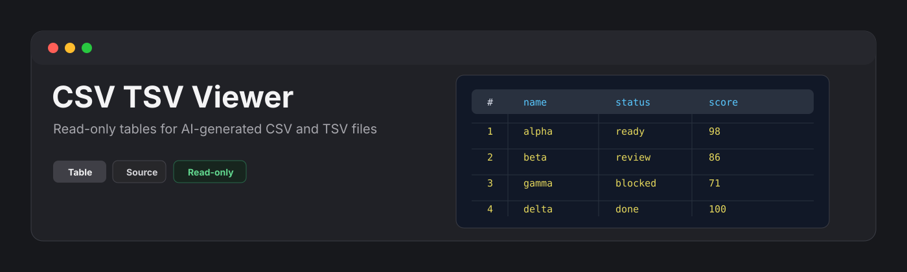
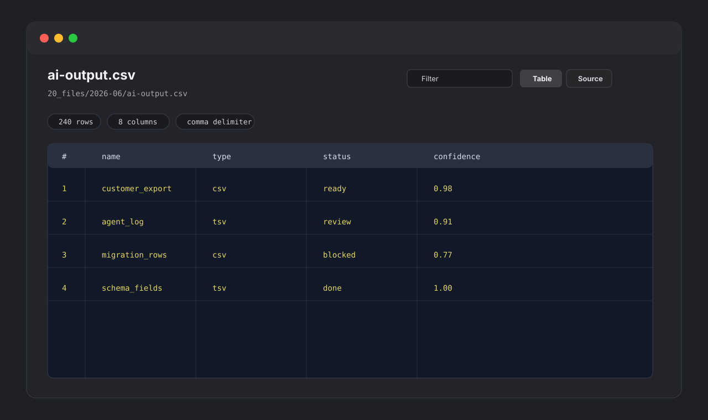

<p align="center">
  
</p>

<p align="center">
  <a href="https://github.com/viggomeesters/obsidian-csv-tsv-viewer/releases/latest"></a>
  <a href="LICENSE"></a>
  
  
</p>

# CSV TSV Viewer

CSV TSV Viewer is a read-only plugin for browsing `.csv` and `.tsv` files as tables. It is built for AI-generated data files, exports, logs, datasets, and quick inspection of delimited text without leaving the vault.



## Features

- Opens `.csv` and `.tsv` files in a dedicated view.
- Shows a table by default.
- Provides a source view with line numbers and lightweight delimiter highlighting.
- Filters visible rows by searching across cells.
- Shows sticky column headers and row numbers.
- Displays row count, column count, delimiter, and render cap status.
- Detects comma and semicolon CSV files.
- Uses tab as the delimiter for TSV files.
- Parses quoted fields, escaped quotes, and multiline fields with Papa Parse.
- Reports parse warnings, uneven row lengths, byte order marks, and large-file render caps.
- Stays read-only by design: it never writes back to data files.

## Large files

CSV and TSV files can become large quickly. CSV TSV Viewer parses the file and renders the first 10,000 rows to keep the view responsive. Additional rows are counted and reported in the warning area.

## Privacy and security

CSV TSV Viewer does not make network requests and does not send vault content to external services. It does not use the system clipboard. It reads files through the vault API and renders a local view.

## Why read-only?

CSV editing is more complex than it looks: quotes, escaped quotes, multiline cells, delimiters, and line endings can all be damaged by a casual edit flow. CSV TSV Viewer intentionally avoids writing to disk in v0.1.

## Installation

### Community plugin directory

CSV TSV Viewer is ready for Community plugin directory submission. Once accepted, it can be installed from **Settings -> Community plugins -> Browse**.

### Manual installation

Until the community directory submission is accepted:

1. Download `main.js`, `manifest.json`, and `styles.css` from the [latest release](https://github.com/viggomeesters/obsidian-csv-tsv-viewer/releases/latest).
2. Create this folder in your vault: `.obsidian/plugins/csv-tsv-viewer/`.
3. Put the downloaded files in that folder.
4. Reload the app.
5. Enable **CSV TSV Viewer** in **Settings -> Community plugins**.

### BRAT installation

For beta testing, install the plugin with [BRAT](https://github.com/TfTHacker/obsidian42-brat) using this repository URL:

```text
https://github.com/viggomeesters/obsidian-csv-tsv-viewer
```

## Usage

Open any `.csv` or `.tsv` file in your vault. The file opens with CSV TSV Viewer.

Use the toolbar to:

- filter visible rows
- switch between table and source views
- refresh the file after external changes

## Development

```bash
npm install
npm run build
npx tsc --noEmit
npm test
```

For local development, copy or symlink this repository into `.obsidian/plugins/csv-tsv-viewer/` inside a test vault.

## Release process

Community plugin files are installed from GitHub releases. For each release:

1. Update `manifest.json`, `package.json`, and `versions.json`.
2. Run `npm install`, `npm run build`, `npx tsc --noEmit`, and `npm test`.
3. Create a GitHub release whose tag exactly matches `manifest.json.version`.
4. Attach `main.js`, `manifest.json`, and `styles.css` as release assets.

The repository includes a GitHub Actions release workflow with artifact attestation support. If GitHub Actions is disabled for the owner account, manual releases are still usable, but automated review may show a recommendation about missing artifact attestations.

## Community directory submission

The repository is prepared for Community plugin submission. The remaining submission step must be completed by the repository owner because it requires signing in, linking GitHub, and confirming the developer policies/support commitment.

Submit this repository URL:

```text
https://github.com/viggomeesters/obsidian-csv-tsv-viewer
```

Steps:

1. Sign in to [community.obsidian.md](https://community.obsidian.md).
2. Link the GitHub account that owns this repository.
3. Open **Plugins -> New plugin**.
4. Enter the repository URL above.
5. Confirm the developer policies and submit.
6. Address any automated review feedback.

The current release is ready for review:

- root `README.md`, `LICENSE`, and `manifest.json` exist
- `manifest.json.version` is `0.1.0`
- GitHub release `0.1.0` exists
- release assets include `main.js`, `manifest.json`, and `styles.css`
- `versions.json` maps supported app versions

Official references:

- [Submit your plugin](https://docs.obsidian.md/Plugins/Releasing/Submit%20your%20plugin)
- [Obsidian releases repository](https://github.com/obsidianmd/obsidian-releases)
- [Papa Parse documentation](https://www.papaparse.com/docs)

## License

[MIT](LICENSE)
